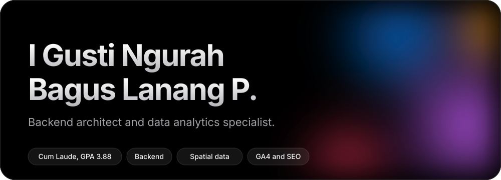
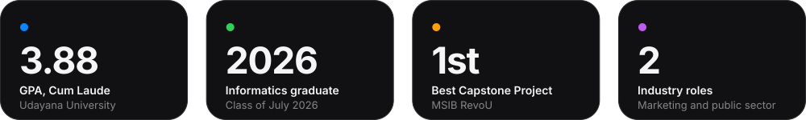
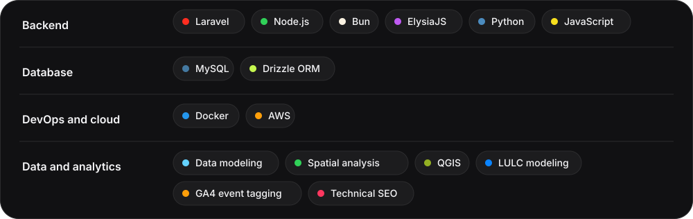
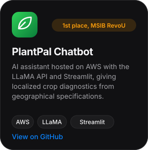
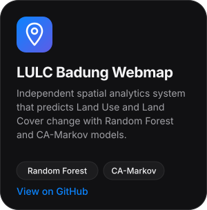
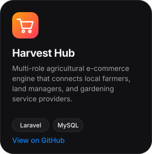
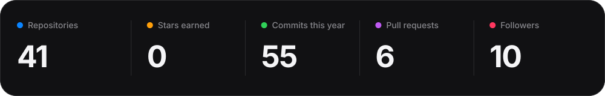
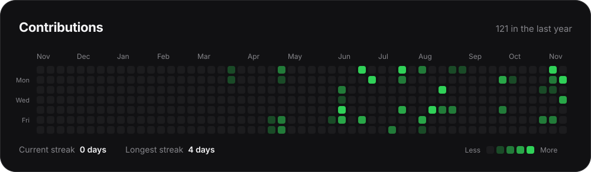
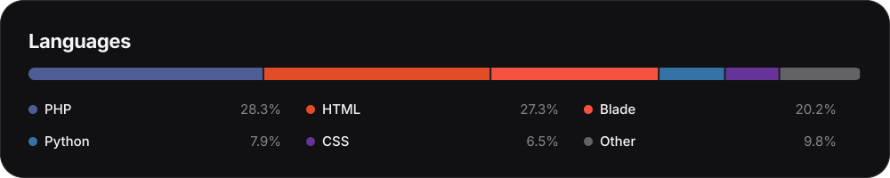

  

  
  

  

## About

Informatics graduate from Udayana University (GPA 3.88/4.00, Cum Laude) focused on backend engineering, spatial data analytics, and high-performance digital products. I connect complex technical logic with data-driven insight, backed by experience in international analytics and public-sector system migration.

- **Now:** elevating enterprise backend structures and building remote-ready, scalable microservices.
- **How I work:** continuous learning, user-centric design, and agile collaboration.

## Stack

  

## Experience

**Web, SEO and GA4 Specialist** at CV. Wonderworxs Digital Marketing *(part-time)* 
Technical web optimization, SEO strategy, and advanced GA4 event tagging for international clients across multiple countries.

**Web Developer** at PT. Djingga Media Teknokreatif *(internship)* 
Led the backend migration, architecture analysis, and UI/UX overhaul of the Denpasar Municipal Government's village administration platforms.

## Selected work

  
  
  

## GitHub in numbers

  

  

  

## Connect

[LinkedIn](https://linkedin.com/in/baguslanangpurbhawa) · [baguslanangpurbhawa@gmail.com](mailto:baguslanangpurbhawa@gmail.com)

  <i>Driven to leverage user-centric design and cross-functional teamwork to build impactful applications.</i>

